# Currency Converter

[](https://apps.microsoft.com/detail/9PC2T04G3V9C)


Convert fiat and crypto currencies without leaving [Command Palette](https://learn.microsoft.com/windows/powertoys/command-palette/overview). Type the way you talk, in your own language and number format, do the maths in the same line, pin the pairs you care about, and keep live rates on the dock, ready the moment you open your launcher.

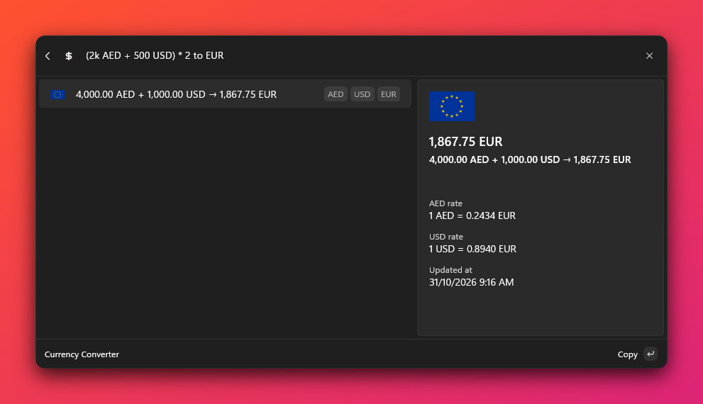

## Why you'll love it

- **Natural language**: codes, symbols, and mixed styles all work (`100 inr to usd`, `$100 to €`, `₽100`)
- **Speaks your language**: `100 долларов в рублях`, `Rs. 500`, `100美元换人民币`, `100달러를 원으로`, and `$` means pesos in Mexico
- **Math built in**: evaluate expressions with BODMAS/PEMDAS and mix currencies in one line (`(2k aed + 500 usd) * 2 to eur`)
- **Shorthands in many languages**: `5k`, `1.5m`, `2 crore`, `5万円`, `3 Mio.`
- **Any number format**: `1.234,56`, `1,234.56`, `1,00,000`, `١٢٫٥`, `三千五百` and `삼만원` all read correctly, and typos like `12..5` or `5x100` are fixed for you
- **Fiat and crypto**: convert in either direction with the free default API
- **Pins + dock**: save conversions and see live amounts on the Command Palette dock
- **Details at a glance**: unit rate, inverse rate, and when the rate was last updated
- **Aliases**: rich built-in currency symbols, plus your own custom aliases
- **Free by default**: unlimited daily rates with no API key required

## Installation

This extension supports both **x64** and **ARM** architectures for all installation methods below.

### Method 1: Microsoft Store

Install Currency Converter directly from the Microsoft Store. Click the badge below to open the store page:

[](https://apps.microsoft.com/detail/9PC2T04G3V9C)

### Method 2: Winget

If you have [Winget](https://learn.microsoft.com/windows/package-manager/winget/) (Windows Package Manager) installed, run:

```
winget install advaith.CurrencyConverterCommandPalette
```

### Method 3: MSIX from GitHub Releases

Download the MSIX package from the [Releases](https://github.com/advaith3600/Command-Palette-Currency-Converter/releases) page. Choose the file that matches your architecture (**x64** or **ARM**) and install it manually.

## Quick start

1. Open Command Palette and type a conversion on the home list (for example `300 cny` or `10*30`). The converted amount appears immediately.
2. Press **Enter** to copy the converted amount, or **Ctrl + Enter** and choose **Open Currency Converter**. You can also run **Currency Converter** and type there (for example `100 usd to eur`).
3. Press **Enter** on a result in the extension to copy the converted amount to the clipboard.
4. Open the details pane on a selected result to see the unit rate, inverse rate, and last update time.

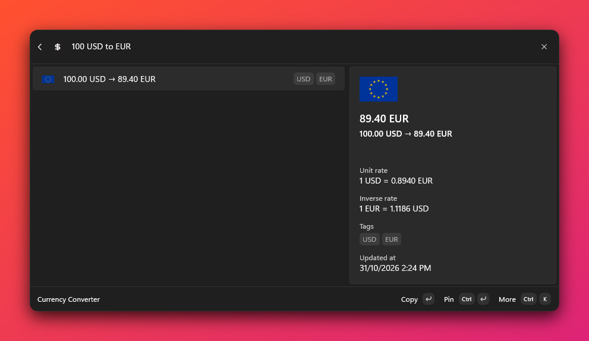

## Usage

Type a conversion in natural language. Currency codes, symbols, and mixed styles all work:

```
100 inr to usd
eur 100 in usd

$100
100R$
100€
100₽
₹100
$100 to eur
100$ to euro
```

Conversion titles always show both source and target (for example `2 USD → 1.86 EUR`). Values use dynamic precision: when an amount is less than 1, the number of non-zero decimal places shown follows your system configuration. If you type a number but Currency Converter can't find a conversion in it, it shows **No conversion found** with an example to try.

On the Command Palette home list, a matching query shows one live conversion (the converted amount, not a loading ellipsis) with the subtitle **Currency Converter**:

- `300` or `10*30`: local currency → first Quick Conversion currency
- `300 cny`: that currency → local (or first Quick Conversion currency if it is already local)
- `300 cny to eur`: that pair

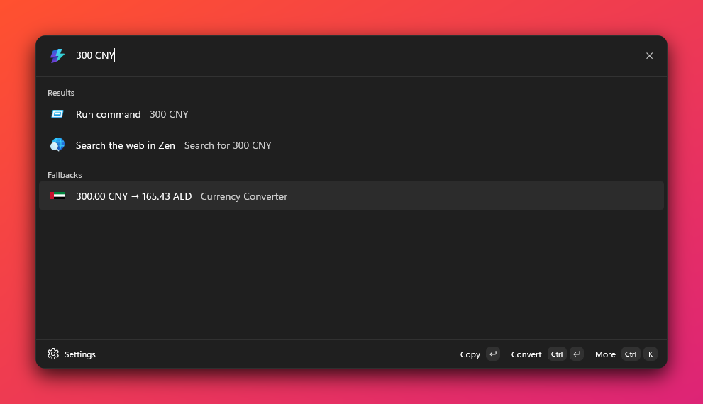

If local and first Quick Conversion currency are the same, a number-only query still appears as **Convert "300" with Currency Converter** so you can open the extension. Network or API errors on the home list use that same title by default (**Suppress fallback warnings**); turn the setting off to see the error instead. When a live conversion is shown, **Enter** copies the amount and **Ctrl + Enter** opens Currency Converter.

### Crypto and other currencies

Convert between fiat and cryptocurrencies in either direction. See the [full list of supported currencies](https://cdn.jsdelivr.net/npm/@fawazahmed0/currency-api@latest/v1/currencies.json).

```
1 btc to usd
0.5 btc to eur
1000 usd to btc
```

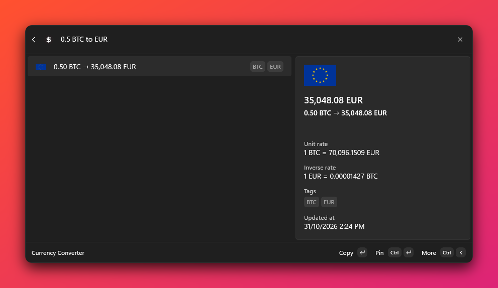

### Quick conversions

Type just a number to convert from your local currency into the other currencies configured in Settings. You can change both the local currency and the list of target currencies there. The same amount is also converted the other way, from each of those currencies back into your local currency.

```
3600
102.2
$1209
```

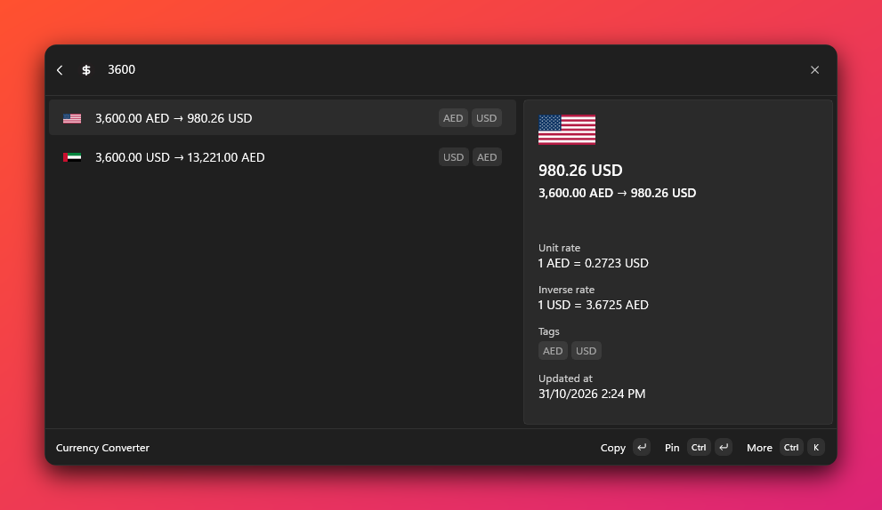

### Mathematical calculations

Type a math expression and the extension evaluates it with BODMAS/PEMDAS before converting. Supported operators are `+`, `-`, `*`, and `/`, including brackets:

```
(12.4 - 34) / 3.3 + 43.3 * 2.22
```

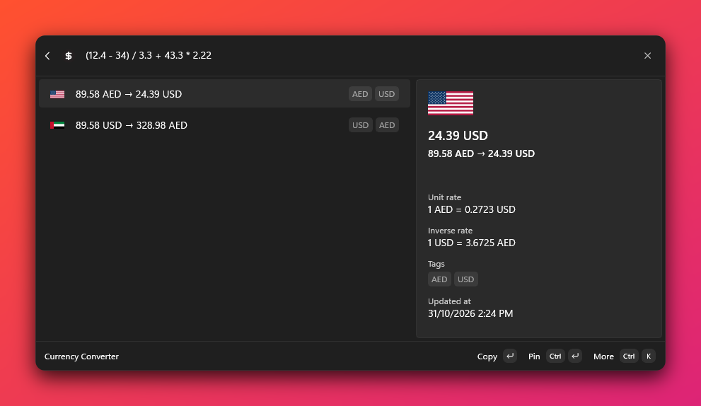

### Mixing currencies

Add or subtract amounts in different currencies and get the total in one currency. With no target, the total is shown in your local currency and every Quick Conversion currency:

```
200 aed + 20 usd to eur
(2k aed + 500 usd) * 2 to eur
$100 - €20
2 * 10 usd + 5 eur in inr
```

Once more than one currency appears, a bare number is in your local currency: in `200 aed + 5 + 20 usd`, the `5` is 5 of your local currency. Use brackets to apply a currency to a whole calculation: `200 aed + (5 + 20) usd` adds 25 USD. Money can be multiplied or divided by plain numbers, but not by other money. Mixed totals can't be pinned, because a pin stores a single amount in a single currency.

### Large-number shorthands

Write big amounts the way you'd say them. A unit can touch the number or follow it after a space, and works anywhere a number does, including inside expressions (`2k + 500 usd`):

| Language | Units |
|---|---|
| English | `k` thousand, `m` / `mn` / `mil` million, `b` / `bn` billion, `t` / `tn` trillion, and the full words |
| Indian | `lac` / `lakh` (10⁵), `cr` / `crore` (10⁷), `हज़ार`, `लाख`, `करोड़` |
| Chinese / Japanese | `百` 10², `千` 10³, `万` / `萬` 10⁴, `亿` / `億` 10⁸, `兆` 10¹² |
| Korean | `백`, `천`, `만`, `억`, `조` |
| German / Italian / Dutch / French | `Tsd.`, `Mio.`, `Mln`, `Mrd.`, `Mld`, `Md`, `Bio.` (10¹²), `Tausend`, `Millionen`, `Milliarden`, `mila`, `milioni`, `miliardi` |
| Spanish / Portuguese | `mil` (10³), `millones`, `mi`, `bi`, `tri`, `milhões`, `bilhões` (10⁹) |
| Russian / Ukrainian | `к`, `тыс.` / `тис.`, `тысяч`, `млн`, `миллионов`, `лям`, `млрд`, `миллиардов`, `трлн` |
| Arabic | `ألف`, `مليون`, `مليار`, `تريليون` |

```
5k usd to eur
1.5m jpy
5万円 to usd
2 crore inr
3 Mio. € in usd
5 mil millones de pesos
```

All units are active whatever your Windows language is. A Latin or Cyrillic unit only counts when no letter follows it, so currency codes written right after the number still work (`5mxn` is 5 MXN, not 5 million "xn"). `l` stays the Honduran lempira alias.

Two units change meaning with your Windows regional format language. `mil` is a million, or a thousand when that language is Spanish or Portuguese. `bn` is a billion (10⁹), or 10¹² when it is French.

### Your language and region

Currency names and the word for "to" work in many languages, and symbols that several countries share follow your local currency:

| Language | Currencies | "to" |
|---|---|---|
| Russian / Ukrainian | `руб`, `рублей`, `₽`, `доллар`, `долларов`, `евро`, `юань`, `грн`, `гривен`, `тенге` | `в`, `во` |
| Spanish / Portuguese | `dólares`, `pesos`, `reais`, `libras` | `a`, `en`, `para`, `em` |
| German / Italian / French | `Franken`, `Pfund`, `dollari`, `sterline`, `livres` | `in`, `nach`, `a`, `en` |
| Hindi / Indian English | `Rs`, `Rs.`, `rupees`, `रुपये`, `रु` | `to`, `in` |
| Filipino | `piso`, `pesos` | `to`, `in` |
| Chinese | `元`, `块`, `人民币`, `美元`, `欧元`, `日元`, `港币`, `新台币` | `换`, `兑换`, `换成`, `到`, `是多少` |
| Japanese | `円`, `ドル`, `米ドル`, `ユーロ`, `人民元`, `ウォン` | `を…に`, `は何…` |
| Korean | `원`, `달러`, `유로`, `엔`, `위안`, with particles like `달러를`, `원으로` | spaces are enough |

Arrows (`→`, `->`, `=>`) mean "to" in every language.

```
100 долларов в рублях
50 reais em dólares
Rs. 500 to usd
100美元换人民币
100ドルは何円
100달러를 원으로
```

Shared symbols and words mean your local currency when it uses them, and otherwise keep their usual meaning:

| Typed | Means | Unless your local currency is |
|---|---|---|
| `$` | USD | another dollar or a peso (MXN, CAD, AUD, ARS, …) |
| `dollar`, `bucks` | USD | another dollar (CAD, AUD, SGD, …) |
| `peso`, `pesos` | MXN | another peso (PHP, ARS, COP, …) |
| `¥` | JPY | CNY |
| `元`, `块` | CNY | TWD, HKD or MOP |
| `kr` | SEK | NOK, DKK or ISK |
| `Rs`, `rupees` (or `₨`) | INR (or LKR) | another rupee (PKR, NPR, …) |

Setting your own alias for one of these, such as `$` to `eur`, always wins.

On a Russian or Ukrainian keyboard layout, `12ю5` and `12б5` read as 12.5 and 12,5, and a code typed in the wrong layout is recognised: `гыв` is USD, `кги` is RUB, `угк` is EUR. Both are labelled under the result.

### Number formats

Type or paste numbers the way you are used to, whatever your Windows region or keyboard. The converter reads the shape of each number instead of assuming one style:

| You type | Read as | Why |
|---|---|---|
| `12,50` or `12.50` | 12.5 | One separator before 1, 2 or 4+ digits is always the decimal |
| `1.234,56` or `1,234.56` | 1234.56 | With both, the last one is the decimal |
| `1.234.567` or `1,00,000` | 1234567, 100000 | A repeated separator groups digits, including Indian grouping |
| `1 234,56`, `1'234.50` | 1234.56, 1234.5 | Spaces and apostrophes only group thousands |
| `0,500`, `,5` | 0.5 | A leading zero or missing whole part means a decimal |
| `1,234` or `1.500` | Depends | Could be either, so your region decides and the other reading is listed last |

Only the last row depends on your region. Pick a fixed style in [Settings](#settings) to stop seeing the other reading.

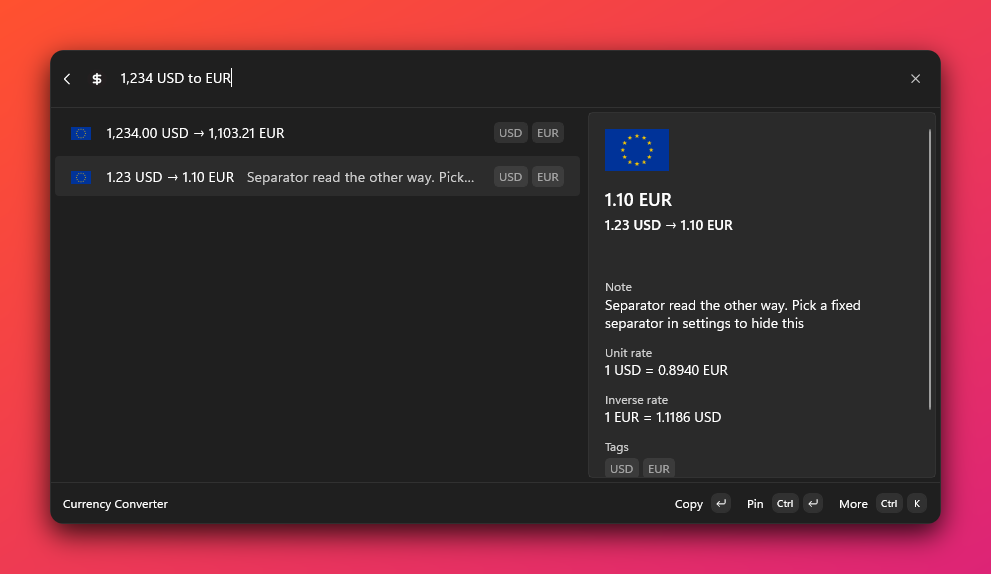

Digits and symbols from other keyboards and pasted text work too: Arabic and Persian digits (`١٢٫٥`, `۱۲`), Indian and Southeast Asian digits such as Devanagari (`१२`), Bengali, Tamil, Thai, Khmer and Myanmar, full-width digits from Chinese, Japanese and Korean input (`１００`), and the `−`, `×` and `÷` signs.

Results are shown in your Windows number format. To paste a result into a spreadsheet or calculator, use **Copy plain number** from the context menu (`Ctrl + K`), which leaves out the thousands separators.

#### Chinese, Japanese and Korean numerals

Numbers written in characters work as well, on their own or mixed with digits:

| You type | Read as |
|---|---|
| `三千五百`, `一百二十三`, `两千零五` | 3,500, 123, 2,005 |
| `一亿五千万`, `三点五万` | 150,000,000, 35,000 |
| `壹仟贰佰叁拾肆`, `壱万円` (banknote forms) | 1,234, 10,000 JPY |
| `삼만원`, `만원`, `일억 오천만원` | 30,000, 10,000, 150,000,000 KRW |
| `3万5千`, `1万5000円`, `1억 5천만원` | 35,000, 15,000, 150,000,000 |
| `一万五`, `两万三`, `三千五` | 15,000, 23,000, 3,500 (labelled, as speech shortens them) |

A numeral only counts when it isn't the start of an ordinary word, so `三星`, `一起`, `일본` and `구글` stay words.

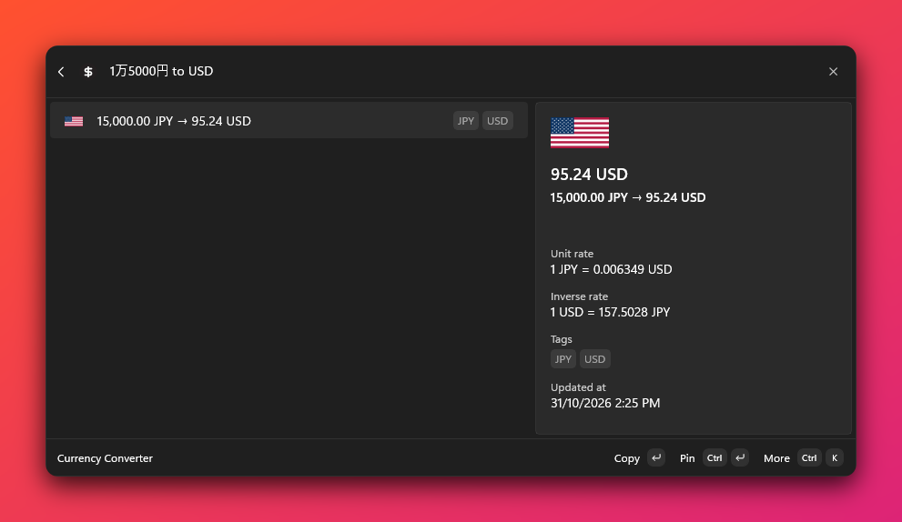

#### Typos

Small slips are fixed without a fuss:

| You type | Read as | The slip |
|---|---|---|
| `12.`, `100,`, `12,-` | 12, 100, 12 | A separator with nothing after it |
| `12..5`, `12,,5`, `12·50` | 12.5 | A doubled separator or a middle dot |
| `5x100`, `3 x 20 usd` | 500, 60 USD | `x` between numbers, read as multiply |
| `100 usd =`, `100 usd to eur?` | 100 USD | A trailing `=` or `?` |
| `(10 + 2 usd to eur` | 12 USD | A missing `)` at the end |

When a number is broken but one reading is clearly most likely, the converter uses it and says so under the result, so a wrong guess is easy to spot:

| You type | Read as | The guess |
|---|---|---|
| `1.234.56` | 1234.56 | The short last group is the decimals |
| `1,2345,678` | 12345678 | The odd grouping in the middle is ignored |
| `1 23 usd` | 123 USD | A stray space inside a number |

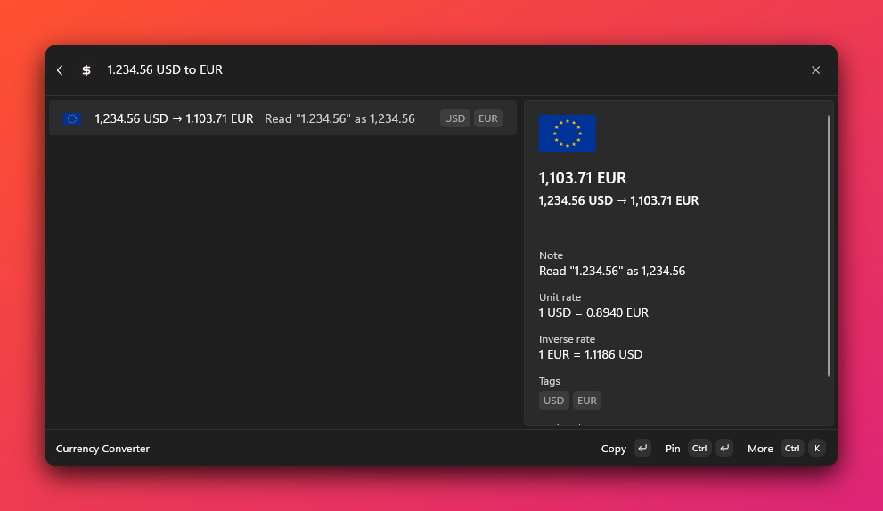

Anything with no clear reading, such as `1,2,3`, `12.5.2` or `1.234,567.8`, is never guessed. You get an error that names the number and what is wrong with it.

## Pins & dock

Pin conversions you check often. They stay at the top of Currency Converter (when the search box is empty) and also appear on the Command Palette dock.

### Pin a conversion

1. Search a conversion, for example `34 btc to aed`.
2. Press `Ctrl + Enter` to **Pin** it (it's also in the context menu, `Ctrl + K`).
3. Open Currency Converter again with an empty search. Your pins load at the top with live rates.

Pins briefly show **Loading…**, then the live amount (or **Loading failed** if the request fails). **Enter** still copies the converted amount; press `Ctrl + Enter` to **Unpin**.

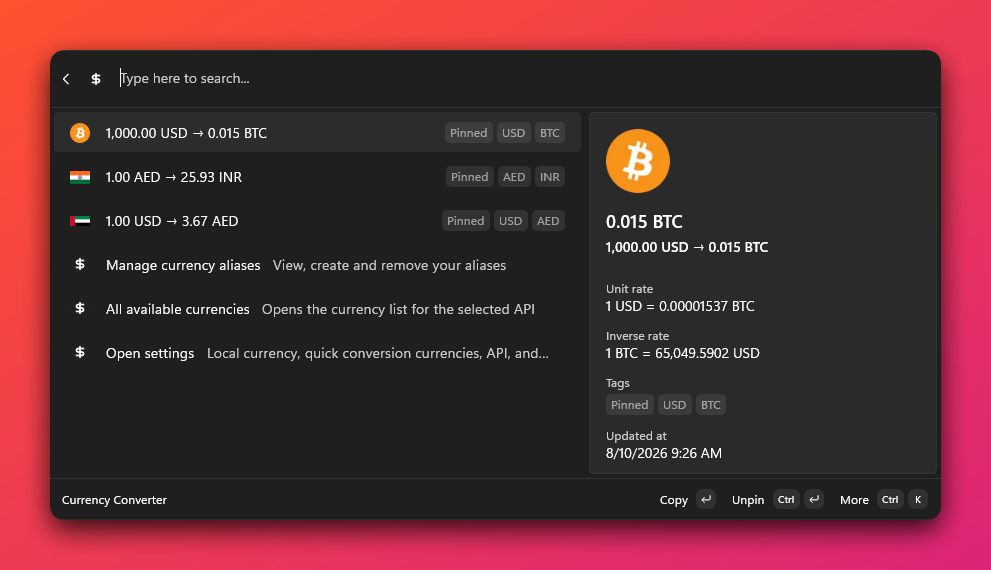

### Currency pins on the dock

The same pins show up in the Command Palette **Currency pins** dock band, so favorite rates are visible without opening the extension.

- **Enter** copies the converted amount
- Context menu: **Refresh** rates for that pin's base currency, or **Unpin**
- Dock rates refresh automatically on a new local calendar day, and whenever you change your pins

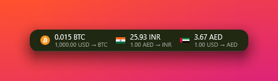

## Aliases

Open **Manage currency aliases** to view, create, and remove currency aliases. Hundreds of built-in symbol aliases (`$`, `€`, `₹`, `£`, and more) ship with the extension so everyday typing just works.

You can also:

- **Export** your alias configuration to your Downloads folder
- **Reset** all aliases to the built-in defaults

Remove an alias by selecting it and pressing `Ctrl + Enter`, then confirming the prompt.

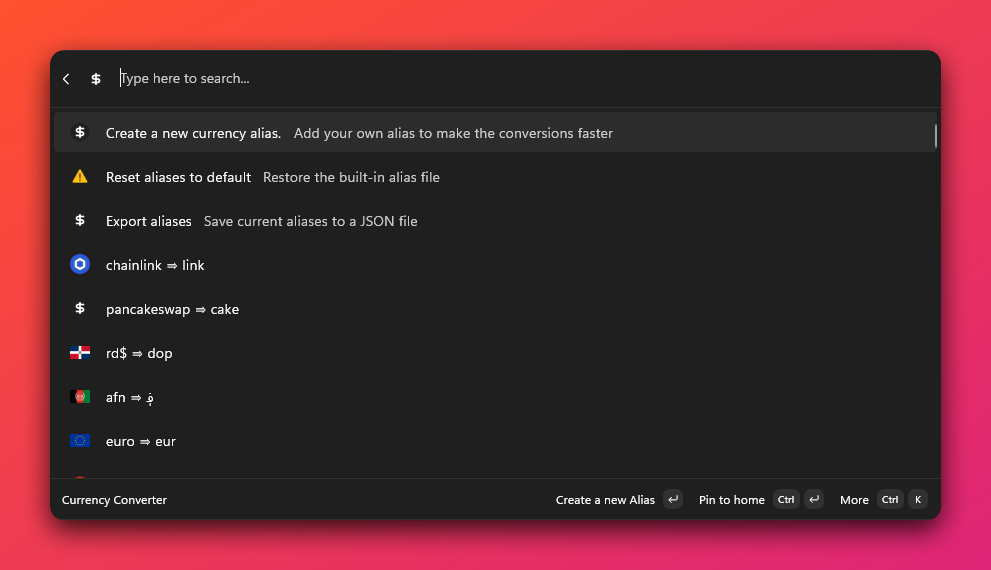

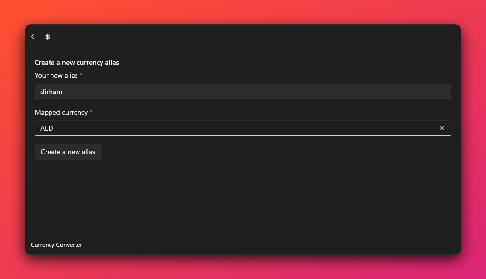

## Settings

Open Settings from the Currency Converter command (context menu → Settings).

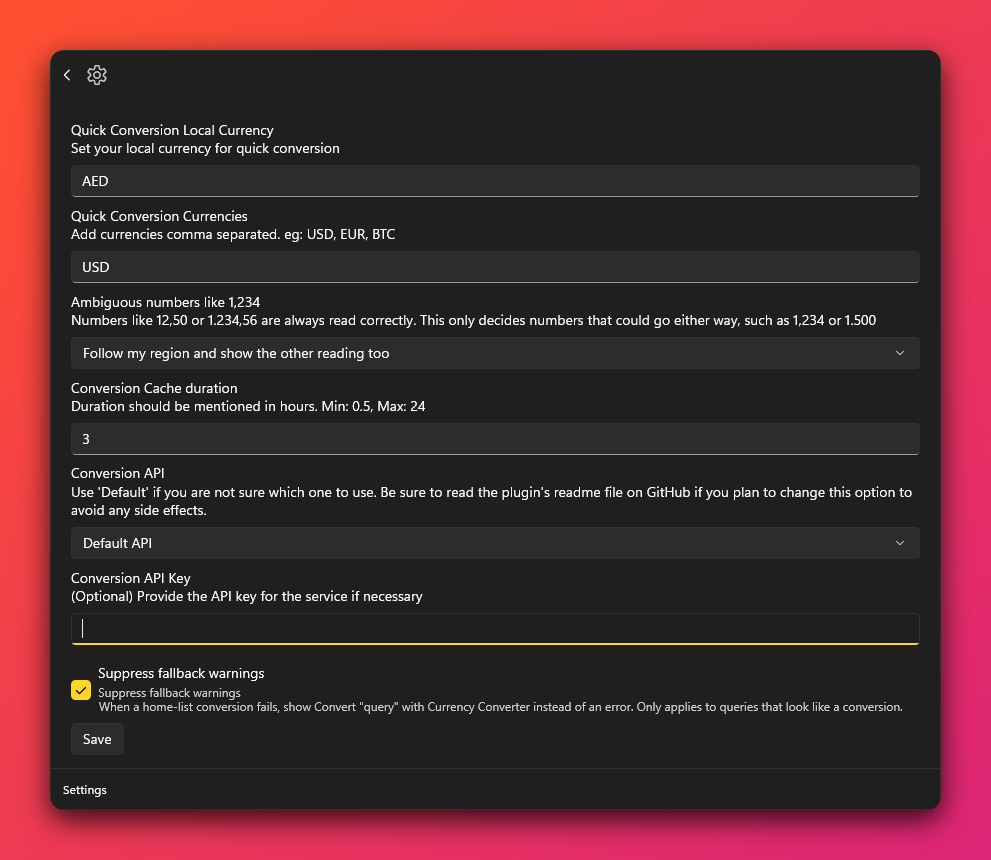

| Setting                             | What it does                                               |
| ----------------------------------- | ---------------------------------------------------------- |
| **Quick Conversion Local Currency** | Base currency for number-only quick conversions            |
| **Quick Conversion Currencies**     | Comma-separated targets (e.g. `USD, EUR, BTC`)             |
| **Ambiguous numbers like 1,234**    | How to read a number that fits either style (see [Number formats](#number-formats)): follow your region and also show the other reading, or always treat the dot or the comma as the decimal |
| **Conversion Cache duration**       | How long rates stay cached, in hours (min `0.5`, max `24`) |
| **Conversion API**                  | Rate provider (see below)                                  |
| **Conversion API Key**              | Required for ExchangeRateAPI, CurrencyAPI, or Twelve Data   |
| **Suppress fallback warnings**      | On by default. Home-list conversion errors show **Convert "query" with Currency Converter** instead of a warning |

## Conversion API

This extension uses third-party APIs for the latest conversion rates:

1. **Default: [fawazahmed0/exchange-api](https://github.com/fawazahmed0/exchange-api)**
   - Refreshed every day at midnight.
   - **Free** and **unlimited**, with no API key required.
   - Supports fiat and cryptocurrency conversions.
   - **Important:** Keep the default API unless you have a strong reason to switch. It updates daily and needs no extra setup.

2. **[Frankfurter](https://frankfurter.dev/)**
   - Free, open-source exchange rates from central banks, with no API key required.
   - No request quotas (abuse rate limits may still apply).
   - Does **not** support cryptocurrency conversions.
   - Uses the public Frankfurter [v2 rates API](https://frankfurter.dev/).

3. **[ExchangeRateAPI](https://www.exchangerate-api.com/)**
   - Updated frequently throughout the day ([pricing](https://www.exchangerate-api.com/#pricing)).
   - Free tier: 1,500 requests per month.
   - Does **not** support cryptocurrency conversions.
   - Requires an API key in Settings.

4. **[CurrencyAPI](https://currencyapi.com)**
   - Updated frequently throughout the day ([pricing](https://currencyapi.com/pricing/)).
   - See their documentation for update frequency, pricing, and supported features.
   - Requires an API key in Settings.

5. **[Twelve Data](https://twelvedata.com/)**
   - Provides real-time exchange rates for supported forex and cryptocurrency pairs.
   - Free tier: 8 API credits per minute, up to 800 per day ([pricing](https://twelvedata.com/pricing)).
   - Requires an API key in Settings.

None of these APIs are affiliated with this extension. To use a different rate provider, or to suggest a new one, open a pull request.

## Privacy

This extension has no analytics or telemetry. Settings, aliases, and pins stay on your device; exchange rates are fetched from the third-party API you select. See the [Privacy Policy](PRIVACY_POLICY.md) for details.

## License

This project is free software licensed under the [GNU General Public License v3.0 or later](LICENSE). You can use, modify, and sell it; if you distribute it, you must keep it open source under the GPL.

A few files originally from Microsoft's Command Palette extension template remain under the MIT License (see the copyright headers in those files). MIT is compatible with GPL-3.0.
